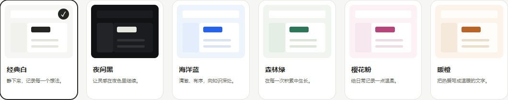
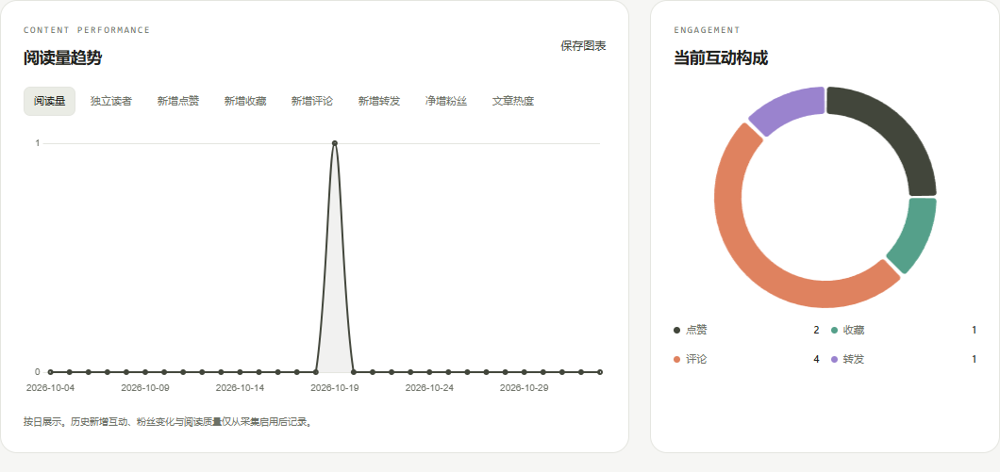

# 我的知识小栈 / Knowledge Stack

ASP.NET WebForms 个人博客与笔记管理系统，覆盖前端、后端和关系型数据库。

整理日期：2026-11-02。本仓库为课程项目源码，面向 Windows 本地开发。

## 技术栈

| 层次 | 技术 |
| --- | --- |
| 后端 | C#、ASP.NET WebForms、.NET Framework 4.7.2、Session |
| 前端 | HTML、CSS、原生 JavaScript、Flexbox/Grid、fetch |
| 数据库 | SQL Server Express LocalDB、ADO.NET |
| 数据访问 | 自定义 DAL、参数化 SQL、事务与增量迁移 |
| 图表 | 本地 Chart.js 4.5.1 |

## 已实现功能

- 注册、用户名/邮箱登录、退出、资料及密码修改，文章管理权限隔离。
- Markdown 编辑与预览、文章 CRUD、分页、草稿、撤回和回收站。
- 17 个固定学科多选、标签块添加/移除、搜索与排序。
- 图片上传与正文拖图，文章和评论支持 Emoji。
- 文章点赞、收藏、评论、一级回复及评论/回复点赞。
- 关注、粉丝、动态、引用转发、通知和举报处理。
- 七天文章热榜、热门标签、活跃作者、真实搜索热词与搜索历史。
- 六套主题、18 项颜色、账号自定义保存、实时预览与对比度改善。
- 作者私有后台：阅读、互动、粉丝、热度、时长、完读率与互动率。
- 日期筛选、前期对比、单篇分析、最多三篇阅读对比及 CSV/PNG 导出。

图表仅使用实际数据库统计，未采集过的历史不补造。





截图来自本地示例账号，数据量仅用于展示当前功能。

## 首次运行

1. 在 Windows 安装 Visual Studio 的“ASP.NET 和 Web 开发”工作负载、.NET Framework 4.7.2 目标包、IIS Express 及 SQL Server Express LocalDB。
2. 打开 `WebApplication2.slnx`。若不支持 `.slnx`，直接打开 `WebApplication2/WebApplication2.csproj`，或将该项目加入空白解决方案。
3. 通过 Visual Studio 还原 `WebApplication2/packages.config` 的 NuGet 依赖，再生成工程。仓库不包含 `packages/`、`bin/`、`obj/`。
4. 检查 `WebApplication2/Web.config` 中的 `KnowledgeStackConn`，默认连接本机 LocalDB：

   ```xml
   <add name="KnowledgeStackConn"
        connectionString="Data Source=(localdb)\MSSQLLocalDB;Initial Catalog=KnowledgeStack;Integrated Security=True"
        providerName="System.Data.SqlClient" />
   ```

5. 使用 IIS Express 启动 `WebApplication2`。应用通过 `Global.asax` 自动创建或补齐数据库并执行增量迁移，保留已有数据。
6. 打开实际启动地址下的 `/Default.aspx`。端口以本机配置为准。

空用户库初始化时创建本地示例账号 `demo` / `demo123`，并设为演示管理员。它是公开的教学凭据，不能作为实际对外服务的管理员口令。已有用户库不会重新补建该账号。

通常无需手动初始化。必要时可在本机访问 `/Setup.aspx`，要求 `EnableLocalSetup=true`；初始化不会清空数据库。

迁移包含 `CREATE OR ALTER TRIGGER`，数据库引擎需要 SQL Server 2016 SP1 或更新版本。

## 数据库与数据交接

`database/` 包含 `000_core.sql` 至 `004_studio.sql`。自动启动初始化基础表，并依次执行嵌入的扩展迁移。手动升级前先备份、确认目标数据库，按编号顺序执行全部五个脚本，不要漏掉主题与统计迁移 `004_studio.sql`。

例如在目标库已经存在且已执行 000～003 后：

```powershell
sqlcmd -S "(localdb)\MSSQLLocalDB" -E -d KnowledgeStack -b -f 65001 -i .\database\004_studio.sql
```

账号、文章、评论、图片和头像保存在数据库中。源码不包含本机业务数据、数据库文件或备份。复制代码不会同步另一台电脑上的文章，需要单独备份并恢复数据库。

## 代码结构与自定义类

```text
WebApplication2.slnx
WebApplication2/
  DAL/          数据访问和数据库迁移
  Services/     社区、主题、统计服务
  Handlers/     JSON 和媒体接口
  Models/       用户与文章模型
  Utils/        权限、密码和 Markdown 工具
  Content/      样式和图标
  Scripts/      编辑、互动、主题及图表
database/       数据库脚本 000～004
tests/          接口和前端流程验收
docs/           功能说明和界面截图
```

自定义数据库操作类包括 `DbHelper`、`CommunityDAL`、`PostDAL`、`UserDAL`、`TaxonomyDAL`、`DatabaseInitializer` 和 `SchemaMigration`。`AppearanceService` 与 `AnalyticsService` 负责主题和统计业务。社区服务中也含有 SQL，并非所有 SQL 均已抽离至 DAL。

## 测试

拖图流程测试：

```powershell
node --test .\tests\editor_images.test.cjs
```

HTTP 验收使用 Python 标准库和 `sqlcmd`，会创建和清理临时账号、文章。只在专用测试环境运行。

- `tests/local_acceptance.py` 默认连接 `http://localhost:59776/` 和 `KnowledgeStack`，需要示例管理员；执行前核对 `BASE`、`sql()` 与账号。
- `tests/studio_acceptance.py` 通过 `KNOWLEDGE_STACK_TEST_URL` 和 `KNOWLEDGE_STACK_TEST_DB` 配置独立环境。默认端口 59778，数据库 `KnowledgeStackStudio20261026`。脚本不会自动启动网站，具体保护条件见源码。

Node.js 与 Python 仅用于测试，网站没有 Node 后端或 npm 构建步骤。

## 功能文档与范围

- [完整功能清单](docs/功能完成清单.md)
- [主题与创作数据规则](docs/个性化主题与创作数据.md)
- [分类与标签规则](docs/分类与标签改造说明.md)
- [评论点赞与 Emoji](docs/评论点赞与Emoji说明.md)
- [后续功能清单](docs/后续功能修改清单.md)

私密笔记、收藏夹、相关推荐、拉黑、浏览历史、AI 翻译和背景图片等仍属于后续计划。当前源码不代表已完成公网部署。

GitHub 用于存放源码；GitHub Pages 无法直接运行此 WebForms 后端和 LocalDB。

## 第三方许可

本地 Chart.js 的 MIT 许可见 [许可原文](WebApplication2/Scripts/vendor/Chart.js-LICENSE.md)。NuGet 依赖由原发布方许可约束。

项目自身尚未指定开源许可证，公开上传不等于授予任意复制、修改或再分发许可。
